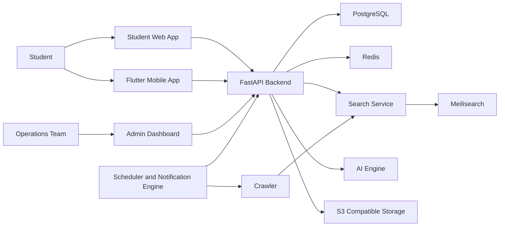

# System Overview

Elevra is organized around independently deployable product and platform capabilities.

Core services should communicate through typed HTTP contracts initially, with event-driven
workflows introduced when throughput or coupling requires it.
